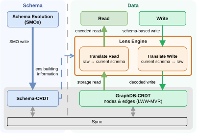
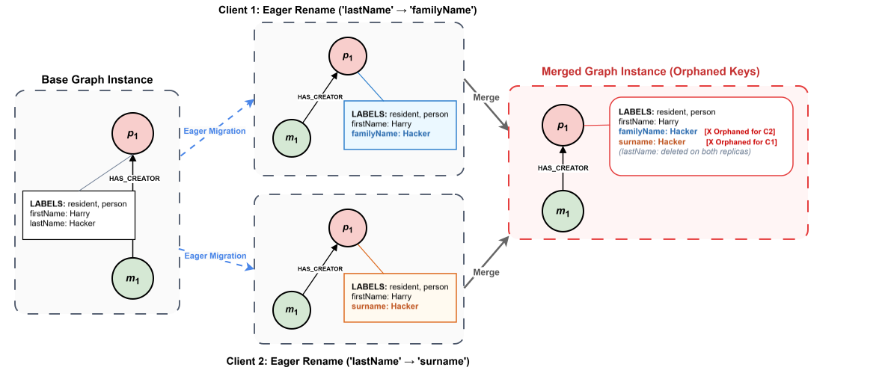

<h1 align="center">REFRACT</h1>

<p align="center">
  <b>Coordination-Free Schema Evolution for Replicated Property Graphs</b><br>
  <a href="https://dl.acm.org/doi/10.1145/3799682.3840015">Paper (CIKM '26)</a> ·
  <a href="./0_Additional_Explanatory_Material/REFRACT_Poster_CIKM26.pdf">Poster</a>
</p>

Replicas change schema and data locally, without coordination, and still converge
on a single merged schema and a consistent view of the data. Schema changes never
rewrite stored data all translation happens on interactions.

Reference implementation and experimental data for the CIKM '26 paper by
Michael Landgraf, Annette Bieniusa and Stefania Dumbrava.

<p align="center">
  
  <br>
  <small><i>REFRACT separates schema management from data management, with a lens engine mediating between them.</i></small>
</p>

## Quick start

Requires Node.js (implemented on v22.12.0 / npm v10.9.0).

```bash
git clone https://github.com/MichaLandgram/REFRACT.git
cd REFRACT
npm install
```

Multi-replica setups use `y-websocket` as the connection provider.

## Results at a glance

Evaluated on the LDBC Social Network Benchmark (SF3), against Cambria (the
document-level state of the art) and against eager migration on the same
GraphDB-CRDT storage backend.

| | REFRACT vs. baseline |
| --- | --- |
| **Schema-change downtime** | Near-constant in dataset size. At 10K nodes, up to **492×** lower than eager migration for a global label rename; **90–110×** lower for node-level `CHANGE` and `SPLIT`. |
| **Read-path cost** | Per-node translation roughly **an order of magnitude below Cambria**, while additionally expressing graph-level operations and producing a single merged schema. |
| **Throughput under evolution** | A schema change mid-workload leaves throughput **steady**; eager migration blocks the event loop and drops to 0 ops/s for the duration. |
| **Scaling** | Aggregate throughput grows **near-linearly** from 1 to 4 replicas. |
| **Storage overhead** | Constant in absolute terms under a fixed schema (≈14 % at 100 nodes down to ≈0.03 % at 10K nodes); ≈7 % for schemas up to 100 types. |

See the paper for the full evaluation (RQ1–RQ7) and figures, or
[Reproducing the experiments](#reproducing-the-experiments) below.

## The problem



The goal is to remove the downtime and blocking that coordinated schema evolution
introduces, while still giving every replica a consistent view of the data. In a
coordination-free setting, that means dealing with concurrent schema evolution
and its conflicts.

A schema change is not a local data write: a type split or a property retype has
to be merged across replicas *and* reflected onto every affected node and edge.
Naive resolution leaves data that no longer conforms to the merged schema.

REFRACT resolves this by encoding schema modifications as CRDT operations and
deferring all data transformation to a read-time lens.

<br clear="right">

## Architecture

REFRACT separates schema management from data management across three layers:

| Layer | Purpose |
| --- | --- |
| **Schema-CRDT** | Stores the replicated schema and deterministically merges concurrent schema modifications over `NODE TYPE`, `RELATIONSHIP TYPE` and `LABEL`. |
| **GraphDB-CRDT** | Stores and merges schemaless graph data (nodes and edges as CRDT maps, LWW + multi-value registers), preserving referential integrity under concurrent modification. |
| **Lens Engine** | Lazily translates stored data into the current schema at query time, and maps schema-aware writes back to the storage format. |

Nodes and edges carry only property values and a `TYPE` tag, so a schema change
never rewrites data. The physical representation stays stable across schema
modifications, and all structural interpretation happens on the read path.

The schema language is Neo4j's `GRAPH TYPE` [[1](https://neo4j.com/docs/cypher-manual/current/schema/graph-types/)],
which realises the open graph type of the GQL standard.

## Schema Modification Operators

REFRACT supports 19 SMOs, motivated by the work of Bonifati et al. [[2](https://dl.acm.org/doi/10.1007/978-3-030-33223-5_37)],
built from six categories over entities E (`NODE TYPE`, `RELATIONSHIP TYPE`,
`LABEL`) and attributes A (labels, properties):

| Operation | Description |
| --- | --- |
| `CREATE(E)` | Creates entity E; fails if it exists locally. A new node type auto-creates its labels if necessary. |
| `DROP(E)` | Removes entity E; dropping a label cascades to node type label sets and dependent relationship types. |
| `RENAME(A)` | Renames an attribute (global label or local property key); a label rename cascades to label sets and relationship types. |
| `CHANGE(A)` | Adds/removes properties in types, adds/removes labels in node types, or retypes a property. |
| `JOIN(E1, E2)` | Merges two entities into one, taking the union of their label sets and properties. |
| `SPLIT(E)` | Refines an entity into multiple entities; the new types inherit labels and properties. |

### Conflict resolution of Retyping

Concurrent retypings are resolved by a *type lattice*
(`String ≻ Number ≻ Date ≻ Bool`), ordered by information containment, so the
least upper bound always admits a well-defined coercion. The coercion applies at
the view layer only. The original typed value stays intact in storage and is
recoverable if the schema later restores its type.


## Repository structure

```
src/
├── Schema-CRDT/    # replicated schema; merges concurrent SMOs
├── GraphDB-CRDT/   # schemaless node/edge storage (LWW + MVR)
├── Lens/           # read-time translation and write-back
└── Connectors/     # use REFRACT with an external query engine
Test/               # unit tests per component
API/                # SMO and query interfaces
```

`Connectors/` lets REFRACT act as middleware handling only schema evolution and
data storage, with the query engine provided by an external graph database.

## Reproducing the experiments

<!-- TODO: fill in the commands and the result/figure paths. -->

| RQ | Question | Command |
| --- | --- | --- |
| RQ1 | Downtime per SMO | `npm run ...` |
| RQ2 | Downtime vs. dataset and schema size | `npm run ...` |
| RQ3 | Per-node read-path translation cost | `npm run ...` |
| RQ4 | Lazy-translation break-even point | `npm run ...` |
| RQ5 | Horizontal scalability (1–4 replicas) | `npm run ...` |
| RQ6 | SMOs under load | `npm run ...` |
| RQ7 | Schema storage overhead | `npm run ...` |

Baselines are eager migration on the GraphDB-CRDT and Cambria. Workloads are
driven by YCSB; all multi-replica experiments run on a single machine.

## Citation

```bibtex
@inproceedings{landgraf2026refract,
  author    = {Landgraf, Michael and Bieniusa, Annette and Dumbrava, Stefania},
  title     = {Coordination-Free Schema Evolution for Replicated Property Graphs},
  booktitle = {Proceedings of the 35th ACM International Conference on
               Information and Knowledge Management},
  series    = {CIKM '26},
  year      = {2026},
  pages     = {7410--7415},
  numpages  = {6},
  location  = {Rome, Italy},
  publisher = {Association for Computing Machinery},
  address   = {New York, NY, USA},
  isbn      = {9798400725395},
  doi       = {10.1145/3799682.3840015},
  url       = {https://doi.org/10.1145/3799682.3840015},
  keywords  = {property graphs, graph databases, graph schemas, crdts}
}
```

## Authors

- **Michael Landgraf** - RPTU Kaiserslautern-Landau - <landgram@rptu.de>
- **Annette Bieniusa** - RPTU Kaiserslautern-Landau - <bieniusa@rptu.de>
- **Stefania Dumbrava** - ENSIIE, Inria Paris, IRIF, SAMOVAR (Télécom SudParis) - <stefania.dumbrava@ensiie.fr>


## License
The paper is licensed under [CC-BY 4.0](https://creativecommons.org/licenses/by/4.0/), consistent with the ACM open-access terms of the original publication.

## References

[1] Neo4j. *Set Graph Types — Cypher Manual.* https://neo4j.com/docs/cypher-manual/current/schema/graph-types/

[2] A. Bonifati, P. Furniss, A. Green, et al. *Schema Validation and Evolution for Graph Databases.* In ER, LNCS, pages 448–456. Springer, 2019. https://doi.org/10.1007/978-3-030-33223-5_37